# Page d'analyse pas à pas

La page **Analyse** guide l'utilisateur en quatre étapes : quoi analyser, comment l'analyser, suivre la progression, puis lire les résultats (avec flou et export facultatifs). Le fil d'Ariane en haut de page montre où l'on en est et permet de revenir à une étape déjà passée.

Code : [`frontend/src/pages/AnalysisPage.jsx`](../frontend/src/pages/AnalysisPage.jsx) et [`frontend/src/components/analysis/wizard/`](../frontend/src/components/analysis/wizard/).

## Page de connexion

La page de connexion est aussi la page de présentation du produit : ce que fait LiSA (données sensibles, relations, classification, contrôles de sécurité, documents réels, flou et anonymisation), ce qui garantit que les données restent dans le système (aucun appel à un LLM externe, modèles embarqués), le parcours en quatre étapes, un aperçu des écrans, puis ce qui rassure (authentification unique, règles par projet, historique, déploiement sur votre infrastructure). Le bouton *Se connecter* envoie vers Keycloak ; un utilisateur déjà connecté est renvoyé vers l'application.

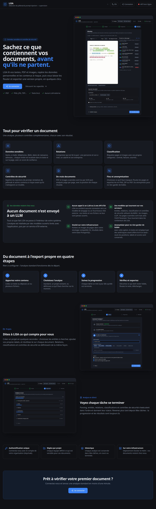

## 1. Source : un texte ou un fichier

Deux cartes au choix. La carte sélectionnée s'ouvre et affiche sa zone de saisie.

**Un texte** : on colle ou on saisit le texte (compteur de caractères). Un saut de page (`\f`) coupe le texte en pages.

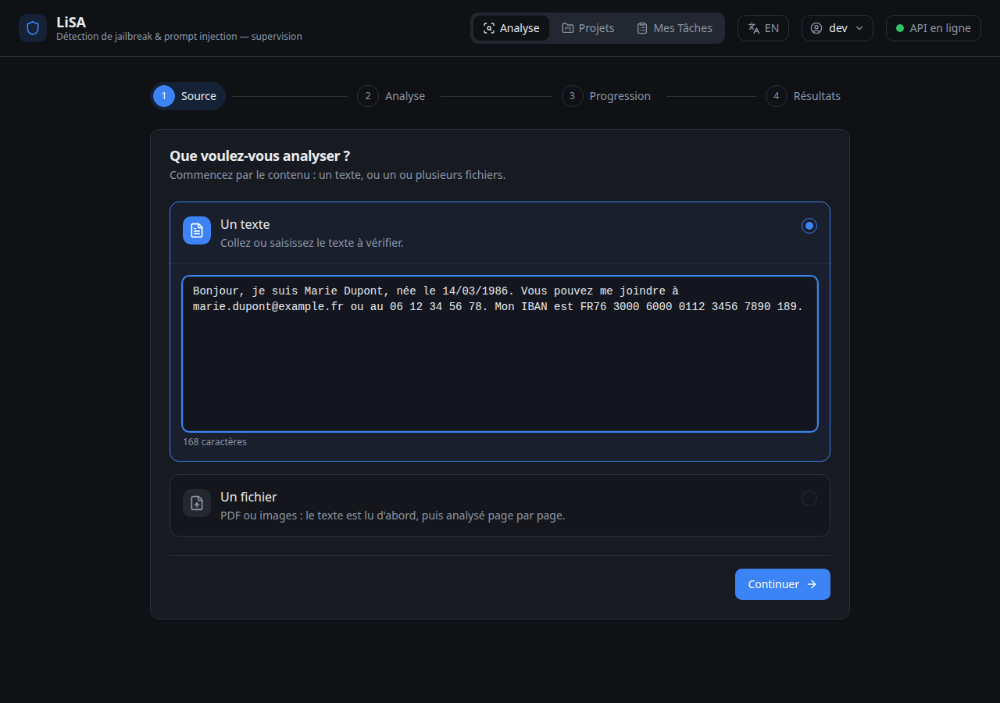

**Un fichier** : glisser-déposer ou parcourir. PDF, PNG, JPG, TIFF, BMP, WebP, plusieurs fichiers possibles, chacun retirable.

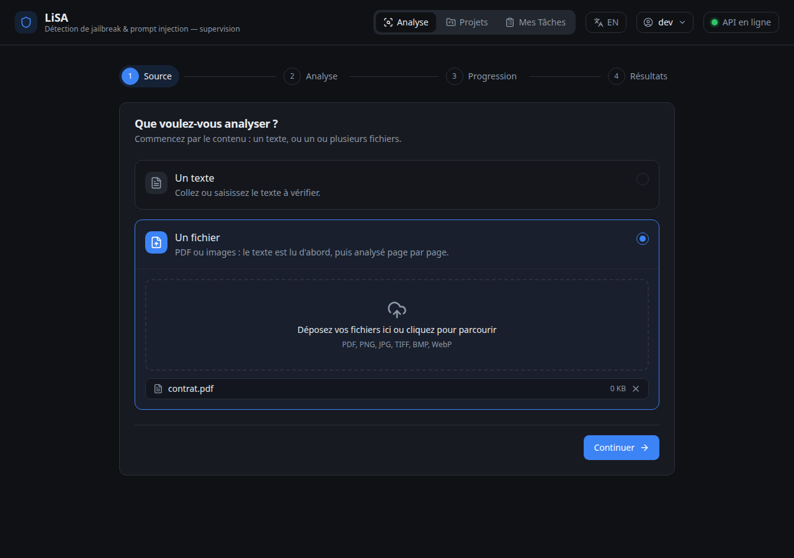

*Continuer* reste grisé tant qu'il n'y a rien à analyser.

## 2. Analyse : standard, projet existant ou nouveau projet

Trois cartes, la première est recommandée.

**Analyse standard** : informations personnelles et contrôles de sécurité par défaut. Rien à configurer.

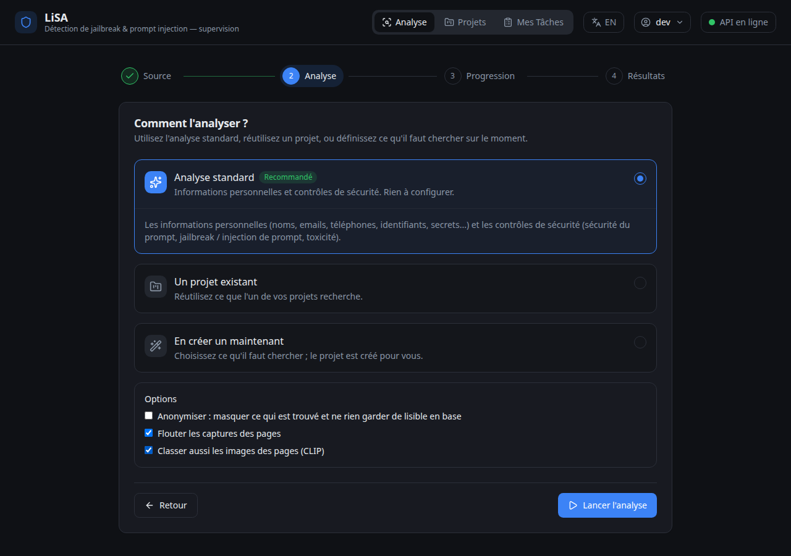

**Un projet existant** : on choisit un projet, puis on active ou désactive chaque définition (entités, relations, classifications, contrôles de sécurité) sous forme de pastilles. Tout ce qui est activé dans le projet est coché au départ.

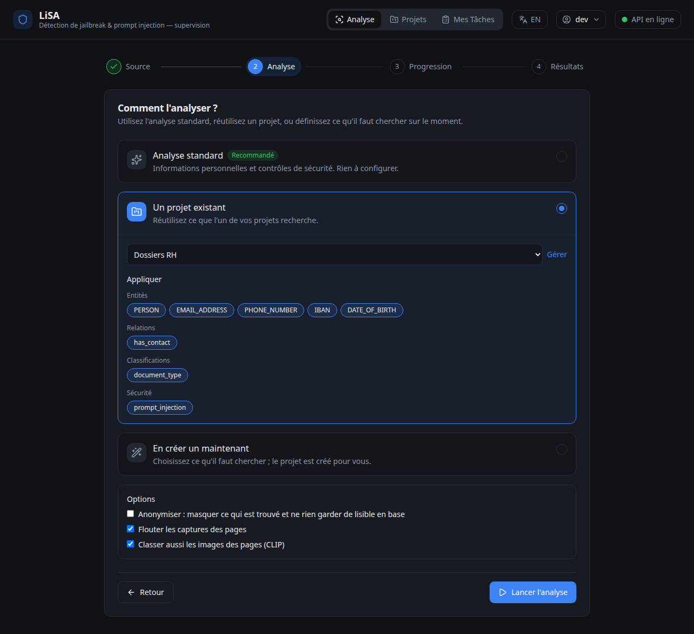

**En créer un maintenant** : un nom et les labels à chercher (pastilles prêtes à l'emploi, plus un champ pour en ajouter). Le projet et ses entités sont créés au lancement, et réutilisés si on revient en arrière puis relance sans rien changer.

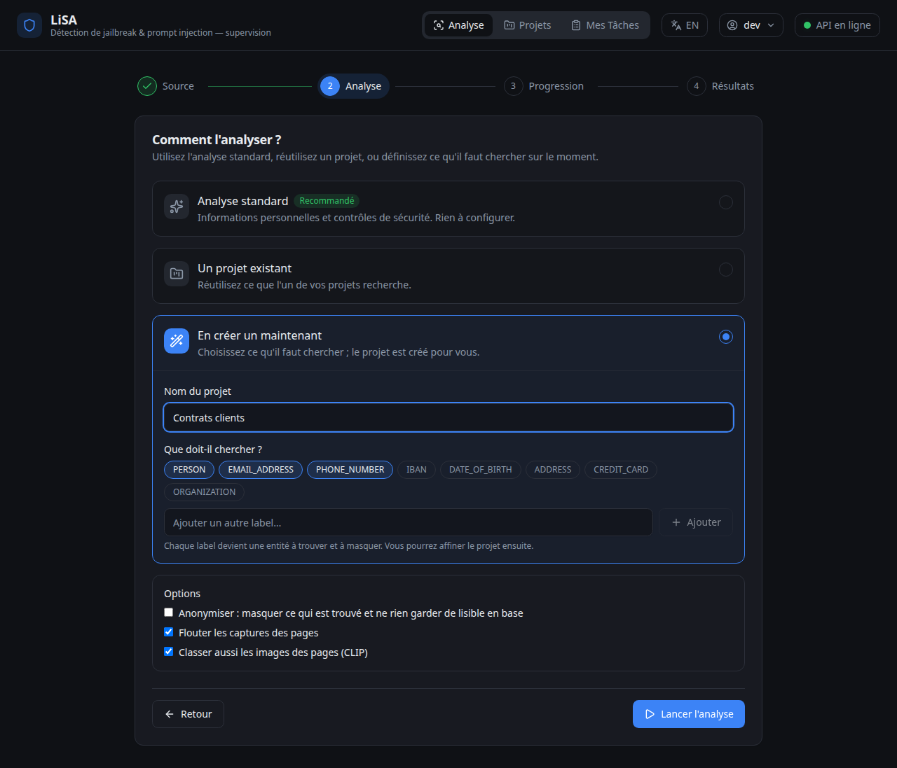

Les **options** sont en bas : anonymiser (rien de lisible en base) et, pour les fichiers, flouter les captures de pages et classer aussi les images.

## 3. Progression

Une barre globale et une ligne par tâche (parsing, entités, relations, classifications, sécurité, images, anonymisation) avec son statut, sa progression et sa durée. Dès que le run est terminé, on passe seul aux résultats. En cas d'erreur, un bouton *Réessayer* apparaît.

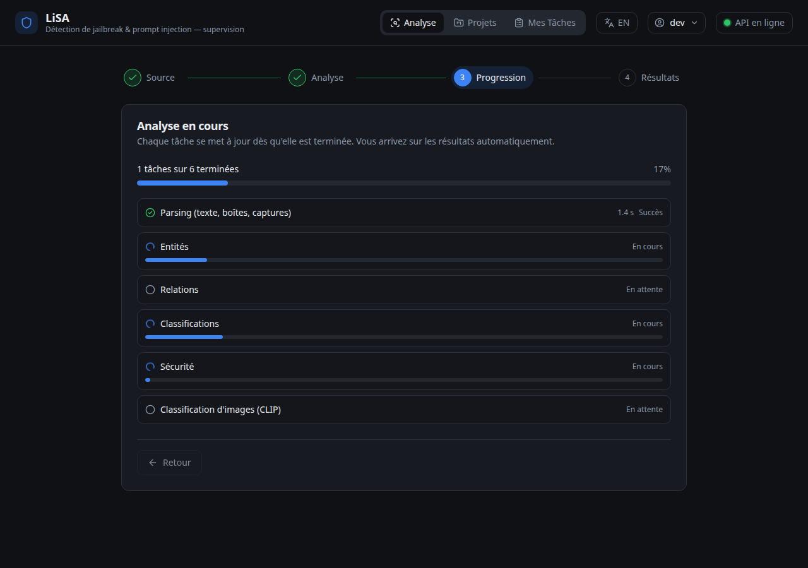

## 4. Résultats

Une seule vue, pensée pour qu'il n'y ait rien à apprendre.

**En haut**, une ligne de résumé : pages, entités trouvées, alertes de sécurité, durée. Une bannière rouge apparaît sur les pages où une alerte de sécurité a été levée.

**À gauche**, le document page par page (image ou texte, avec les entités surlignées). **À droite**, ce qui a été trouvé sur la page. Chaque entité est cochée au départ : *cochée = masquée à l'export*. On décoche ce qui doit rester lisible ; *tout* / *rien* agissent sur la page courante. Survoler une ligne ou un surlignage allume l'autre.

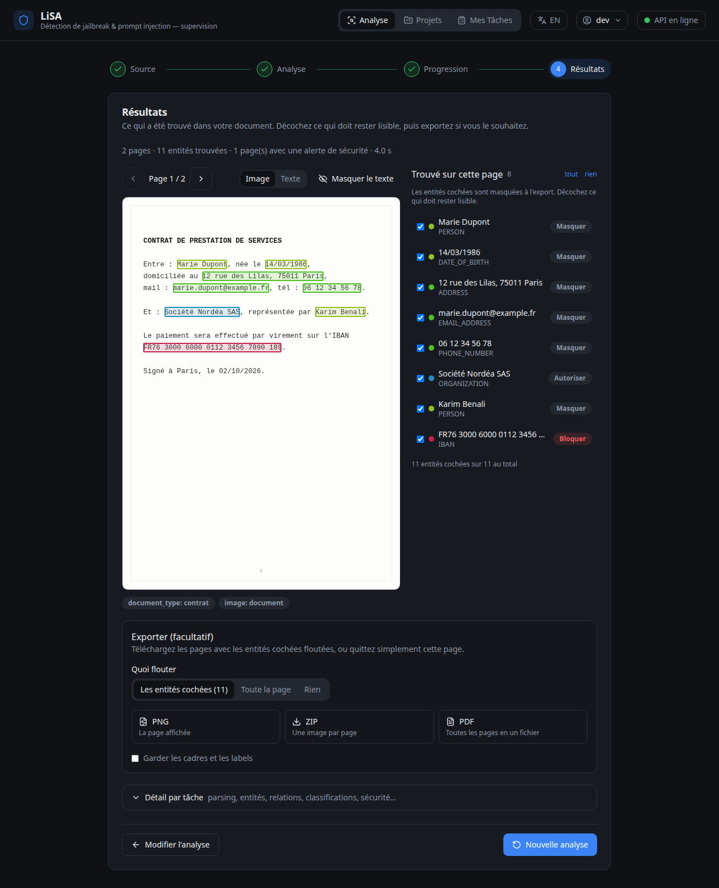

**En dessous**, l'export, facultatif : on choisit quoi flouter (les entités cochées, toute la page ou rien), puis on télécharge en **PNG** (page affichée), **ZIP** (une image par page) ou **PDF** (toutes les pages). « Garder les cadres et les labels » dessine les boîtes avec leur label. Si rien n'est coché, l'interface prévient que les pages seront exportées sans modification. On peut aussi ne rien exporter et cliquer sur *Nouvelle analyse*.

**Tout en bas**, une section repliée *Détail par tâche* donne le résultat brut de chaque tâche (parsing, entités, relations, classifications, sécurité, images), pour qui veut aller plus loin.

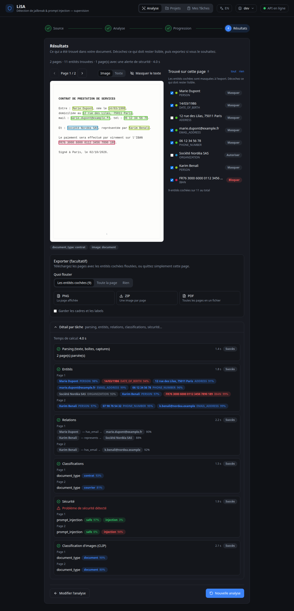

Pour un **texte**, il n'y a pas de capture de page, donc pas de flou à l'export : on garde les surbrillances et le bouton *Masquer le texte*.

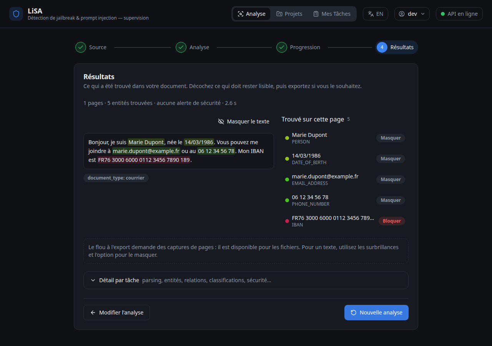

## Retrouver une analyse : Mes tâches

*Mes tâches* liste les analyses lancées (une ligne par analyse, pas par tâche technique) avec leur source, leur statut, leur progression et leur durée.

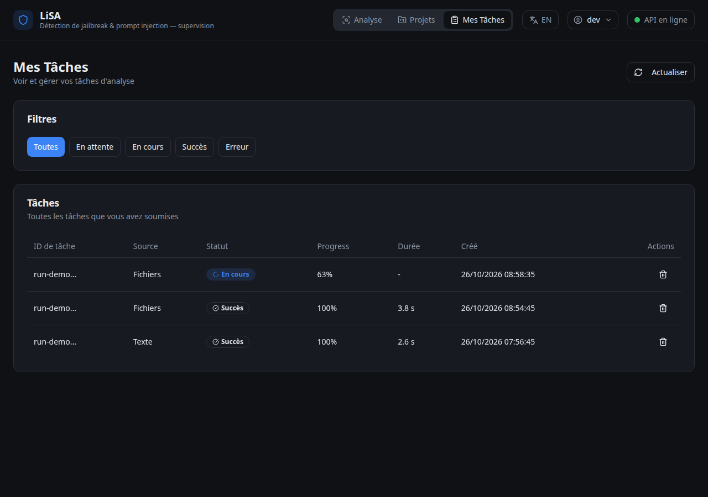

Cliquer sur une ligne ouvre l'analyse dans la **même vue que la page d'analyse**, à l'étape où elle en est. Les étapes *Source* et *Analyse*, choisies au lancement, ne sont plus modifiables.

**Analyse en cours** : la progression de chaque tâche, qui se met à jour seule. Quand l'analyse se termine, la page passe toute seule aux résultats.

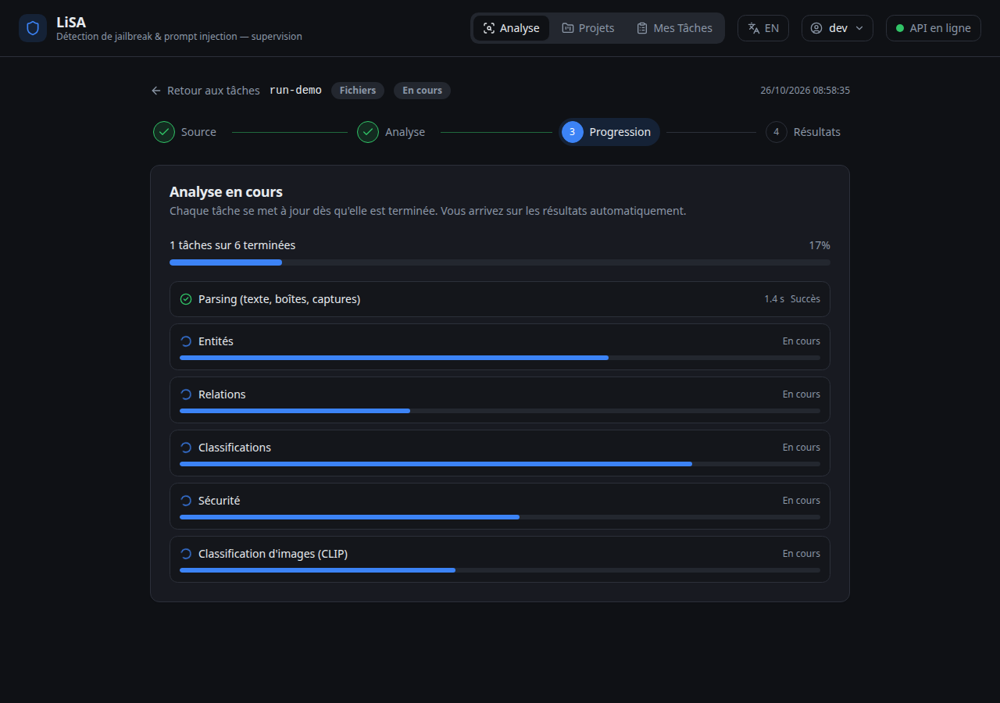

**Analyse terminée** : les résultats, avec la sélection des entités à flouter et l'export, exactement comme à la fin du parcours. Le fil d'Ariane permet de basculer entre *Progression* et *Résultats*.

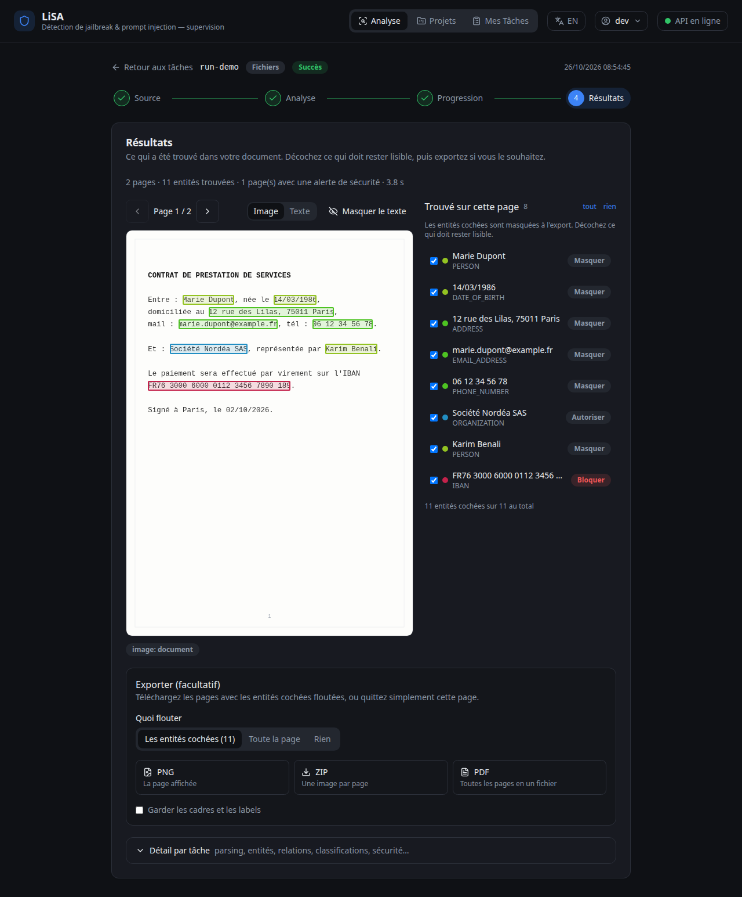

Ouvrir une tâche technique (une étape d'une analyse) renvoie vers l'analyse qui la contient. Une tâche envoyée directement à un service, sans analyse, garde l'ancienne page de détail.
